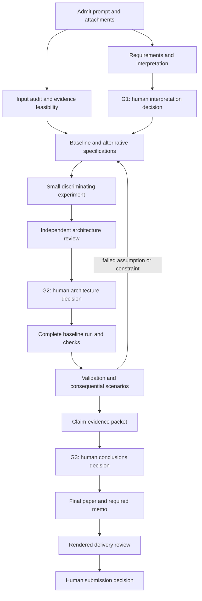

# Execution Playbook: From a New Prompt to an Accepted Answer

This operational companion to [WORKING_DOC.md](WORKING_DOC.md) tells the coordinator what to dispatch, each worker what to produce, and when the next worker may use it. It is a working document, not an installed skill or autonomous scheduler.

The current preparation project excludes all biology-related papers from further research. Use non-biological examples and sources. See [research scope](research/SCOPE.md). The actual problem, current contest rules and the human team's recorded choices govern a future contest project.

## 1. Before opening worker sessions

The coordinator inspects the project and establishes `DOC_ROOT` and `PROJECT_ROOT`. The source library is not the active contest's results folder. Record the problem file and hash, attachments, practice/live mode, deadline with timezone, available tools and human team context.

For executable work, record the actual interpreter/tool path. Each worker checks required imports/capabilities in its own session before the scientific invocation; a parent session's environment check is not transferable proof. Missing dependencies trigger a bounded environment check or explicit blocker, not an unrecorded install or a silently different runtime.

If no problem is supplied, the deliverable is a preparation workflow or a labeled practice fixture. Do not invent an official problem or pretend G1–G3 have been approved for a real contest. No new human checkpoint is needed merely to improve this already authorized preparation document.

If the user explicitly delegates problem selection and a complete autonomous practice run, record that authority in intake and use the [delegated-practice rule](WORKING_DOC.md#22-three-human-checkpoints). Keep G1–G3 evidence and independent review; record `DELEGATED_PRACTICE_DECISION` rather than inventing a human response. This exception does not apply automatically to live competitions or external submission.

Use [the bootstrap prompt](setup/BOOTSTRAP_PROMPT.md). Create or recover these records without overwriting existing work:

| Record | Minimum content |
|---|---|
| `control/state.md` | Stage, accepted versions, deadline, latest complete checkpoint, next actions |
| `control/requirements.md` | Every required answer, source location, form, constraints and owner |
| `control/tasks.md` | Task index with status, dependencies, owner and packet path |
| `control/tasks/Txx.md` | One bounded assignment using the task template |
| `control/role_assignments.yaml` | Actual sessions and exact writable paths |
| `control/decisions.md` | Material decisions, evidence, conditions and actual human responses |
| `control/glossary.md` | Shared entities, units, symbols and time conventions |
| `control/evidence_index.md` | Requirement → model/data/run → result → claim → paper location |

C alone owns `control/`. Workers never maintain competing copies of the accepted board.

## 2. The first useful task for each role

Assign tasks before launching workers. These are distinct responsibilities, not six independent attempts to solve the whole problem.

| Role / session | First question | First owned artifact | Completion evidence | Next recipient |
|---|---|---|---|---|
| coordinator / C | What must we deliver, under which constraints? | Intake, requirements, board and proposed G1 in `control/` | Complete input inventory; every prompt instruction mapped; unresolved interpretations stated | Human G1 and workers |
| domain-data / D | What do the inputs mean, and which missing facts could change the approach? | `research/input_audit-r01.md`, dictionary and source register | Attachment coverage, schemas/units, source locations, known/assumed distinctions | M and X through C |
| modeler / M | What is the smallest representation answering the requirements? | `models/framing-r01.md`, candidates and interface map | Variables, constraints, baseline, alternative, data needs and falsifying test | C, D and R |
| computation / X | Can the input contract and baseline be implemented correctly? | Environment receipt, assigned diagnostic or tiny prototype under `code/` and `runs/` | Actual command/status, schema checks, checkable case and limits | M and R |
| independent-reviewer / R | Does the framing answer the prompt without hiding an important assumption? | `qa/Q01/framing-review-r01.md` | Full prompt and pinned framing inspected; exact findings or scoped acceptance | C and M |
| writer-visuals / W | How will each required answer appear in the deliverable? | `paper/evidence_outline-r01.md` | Requirement-to-section map, audience, needed tables/figures and pending evidence | C and M |

Before G1, M frames alternatives and X may inspect formats or execute explicitly provisional diagnostics. Neither commits the team to an unresolved interpretation. W produces an evidence outline, not invented results. R may wait until a bounded artifact is ready.

## 3. Order and dependencies

Use event-based milestones rather than assuming every problem needs the same number of minutes. Set a first-reading budget and a deadline for the first complete baseline using actual available time.



The writing outline, source verification and independent diagnostics can overlap this chain. A dependency is released by acceptance of an exact artifact version, not a file's existence or a worker saying it is done.

### Intake to G1

1. C assigns T01 input audit to D, T02 framing to M and T03 evidence outline to W.
2. D reads every attachment and footnote. M separately reads the complete prompt; C's paraphrase is insufficient.
3. C reconciles the handoffs into requirements and glossary records. Resolve or explicitly bound discrepancies such as days/nights, annual/total cost and mandatory/optional scenarios.
4. R examines pinned requirements and framing and returns actionable findings.
5. C prepares G1 with a recommended interpretation, alternatives and consequences. Record the human's actual answer. Existing explicit instructions remain authority; do not ask again for an unchanged decision.

### G1 to G2

1. M specifies a credible baseline and a meaningful alternative when there is a consequential choice. A renamed optimizer for the same model is not a different representation.
2. D identifies observed, borrowed, assumed and unidentifiable parameters. X checks whether the proposed experiment fits available tools and time.
3. M fixes comparison conditions and failure criteria before seeing the larger result. C assigns X a bounded prototype.
4. X submits actual outputs and checks. M interprets evidence against its favored approach as well as supporting evidence. R independently checks the decisive claim.
5. C submits the model decision, interfaces and limitations at G2. A provisional architecture can retain named unresolved questions; they do not become validated facts.

### G2 to the first complete answer

1. X builds input → reproducible processing → baseline → result table → feasibility/status checks.
2. M resolves specification ambiguities instead of leaving X to invent parameter meanings.
3. W drafts around accepted tables and marks pending claims explicitly.
4. R checks an independently solvable small case and important constraints on the actual result. Record executed versus inspection-only checks.
5. C preserves this complete checkpoint before authorizing optional complexity. A failed extension must not destroy the last defensible answer.

### First answer to G3 and delivery

1. M proposes experiments that could change the decision, uncertainty or required answer. X runs them under common comparison conditions.
2. M and W propose claim rows; R checks consequential claims against exact evidence.
3. C resolves component conflicts and submits G3. Distinguish conditional findings, best-tested plans, proved optima and unresolved outputs.
4. W reconciles summary, body, tables, figures and the required nontechnical document. Its limitations must survive simplification of the language.
5. R inspects the rendered file. C records its version/hash, review scope and remaining limits. A human handles actual submission unless separately authorized.

## 4. Dispatch work another context can execute

Every packet answers eight questions:

1. **Question:** one bounded output or decision, with requirement IDs.
2. **Inputs:** exact accepted paths and versions/hashes; identify missing inputs.
3. **Owner:** role, actual session and exact writable paths.
4. **Method freedom:** choices fixed already and choices open for investigation.
5. **Evidence:** what must be calculated, read, compared or inspected.
6. **Acceptance:** observable criteria, without requiring a favored candidate to win.
7. **Return conditions:** ambiguity, failure or scope change stopping dependent work.
8. **Handoff:** output paths, recipient, reviewer and next decision.

Populate this dispatch example with actual identifiers:

```text
Task T05, computation session X.
Read control/tasks/T05.md and its exact input revisions.
Question: does the baseline schedule satisfy every travel and occupancy limit?
Implement the accepted specification; do not change its objective or constraints.
Write only code/modeling/baseline_r01.py, runs/E01-r01/,
and handoffs/T05/computation-r01.md.
Record command, environment, input hashes and solver/status information.
Return every constraint check and a counterexample if any check fails.
If day/night semantics are ambiguous, stop the dependent calculation and
send the exact question to the modeler through the coordinator.
Your output is a candidate for review, not an accepted recommendation.
```

Before substantial work, the worker acknowledges inputs actually read, scope, missing dependencies, first action and expected handoff. A missing execution, retrieval or rendering capability must be reported immediately; do not claim the unavailable check was performed.

## 5. Handoff is a three-part exchange

### Producer: evidence package

Write a new revision of the [handoff template](templates/HANDOFF.md). Include exact output versions, the answer, reasoning, checks and limitations. Separate computed, source-reported, assumed and illustrative values. Identify interface conversions and affected downstream artifacts.

### Coordinator: acceptance and routing

Read the handoff and decisive artifacts, check dependencies and ownership, assign review where needed, and record task state. Acceptance is for a specified use: accepting an input audit for design does not establish that the final model is correct.

Canonical review verdicts are `ACCEPTED_FOR_SCOPE`, `CHANGES_REQUESTED` and `INSUFFICIENT_EVIDENCE`. Task states are `READY`, `RUNNING`, `BLOCKED`, `IN_REVIEW`, `CHANGES_REQUESTED`, `ACCEPTED` and `SUPERSEDED`.

| Verdict | Coordinator action |
|---|---|
| `ACCEPTED_FOR_SCOPE` | Check separate human gates/dependencies; accept that artifact/use and release named consumers |
| `CHANGES_REQUESTED` | Assign findings to the owner, preserve the reviewed revision and withhold affected dependent claims |
| `INSUFFICIENT_EVIDENCE` | Name missing evidence/capability and the next task; use `BLOCKED` only for an actual preventing dependency |

A reviewer verdict cannot record a human's approval or accept outputs outside the reviewed scope.

### Consumer: receipt acknowledgment

The next worker reads the accepted version and records a short receipt in its own handoff:

```text
Received: [upstream task and artifact revision/hash].
Using it for: [downstream requirement and quantity].
Interpretation: [units, entity, time basis and schema].
Open issue: [none, or exact unresolved interface].
Next action: [bounded computation/model/writing action].
```

This acknowledgment precedes consequential dependent work. A sent message is not proof of receipt. In manual Claude sessions the human relays the file path; automatic notification is not assumed.

## 6. Defend an approach before defending its result

M writes the reasoning record before implementation and updates it with evidence afterward. W translates it into the paper, without inventing a retrospective rationale to hide selection choices.

| Defense question | Primary owner | Required evidence | Typical failure |
|---|---|---|---|
| What must be decided or estimated? | C + M | Requirement, scope, objective, constraints | Answering a different problem |
| Why this representation? | M + D | Real relationship, abstraction, consequential omissions | Selecting a method by keyword |
| Can inputs support it? | D + M | Definitions, provenance, units, identifiability | More free parameters than evidence can distinguish |
| What does the baseline establish? | M + X | Transparent feasible reference and common metric | Beating an invalid alternative |
| Why add complexity? | M | Missing mechanism or decision-changing diagnostic | More mathematics without gain |
| Does implementation match? | X + R | Correspondence, known case, invariants, status | Plausible output from the wrong equation |
| What could overturn the choice? | M + R | Counterexample, perturbation, independent comparison | Tests chosen only to reassure |
| How strong is the conclusion? | M + W + R | Exact evidence, tested scope, limitations | Best-found described as globally optimal |

A paragraph can follow **requirement → mathematical correspondence → assumption and evidence → fair alternative → observed comparison → bounded conclusion**. Fill it with this problem's facts. A method's popularity or a smooth curve does not establish suitability or accuracy.

See [Approach and Justification](APPROACH_AND_JUSTIFICATION.md) and the [worked defense example](examples/APPROACH_DEFENSE_WALKTHROUGH.md).

## 7. Handle failed checks without losing the project

| Event | Worker action | Coordinator action | Work that can continue |
|---|---|---|---|
| Missing optional source | Record gap and bounded alternative | Prioritize by decision impact | Work independent of it |
| Undefined mathematical choice | Return exact ambiguity to M | Assign clarification; block only affected tasks | Specified modules and outline |
| Failed feasibility | Preserve output and counterexample | Assign model/code repair to its owner | Diagnostics and failure explanation |
| Better alternative found | Report fair comparison and tradeoff | Reopen G2/G3 only if substance changes | Common data and unaffected checks |
| Changed upstream data | Stop using old version for new claims | Mark dependent evidence stale; assign fresh run | Unaffected branches and formatting |
| Review disagreement | Supply evidence or new revision | Record resolution without rewriting verdict | Independent tasks |
| Interrupted session | Leave latest handoff and next action | Reassign after writes stop; preserve outputs | Other owned paths |

The reviewer does not repair a target it independently accepts. If staffing forces author self-review, label it honestly.

## 8. Keep the process proportionate

Six logical roles do not require six paid sessions. With fewer sessions, combine coordination with early writing and sequence research, modeling and computation; retain a fresh reviewer for consequential artifacts. Record role changes and authorship history. Renaming a session does not create independence.

Reach a complete baseline and delivery skeleton early. Reserve validation, writing and export time before optional extensions. When time is short, prioritize required answers, invalid conclusions and feasibility over decorative complexity. Stop an extension when its remaining evidence cost threatens the complete solution and it is unlikely to change the decision.

C should always be able to answer: **what is accepted, what is being checked, who owns the next step, and what prevents the next required answer?** If that requires searching multiple chat histories, repair state and handoffs before adding agents.

## 9. Successful practice rehearsal

- A fresh session recovers the task from files without the original conversation.
- Every required output has an owner and a route into the final document.
- A baseline is checked on an independently solvable small case.
- A deliberately invalid result is rejected for a specific reason.
- A changed input invalidates the right evidence and triggers a fresh run.
- A reviewer traces a claim to its exact table without editing the table.
- The final answer distinguishes performed checks from remaining limitations.

The examples provide practice material. A successful toy calculation does not demonstrate live Claude orchestration. Product setup remains a separate capability check recorded in [verification](qa/VERIFICATION.md).
